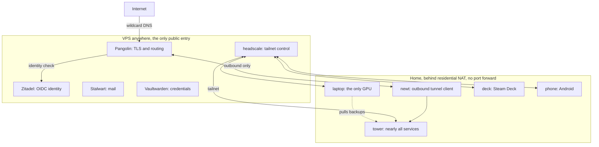
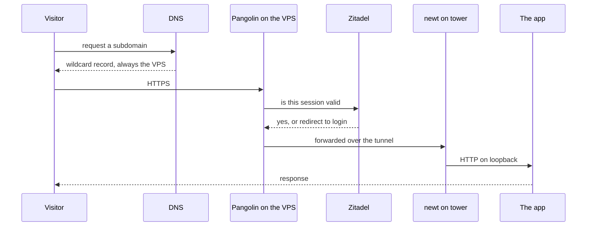
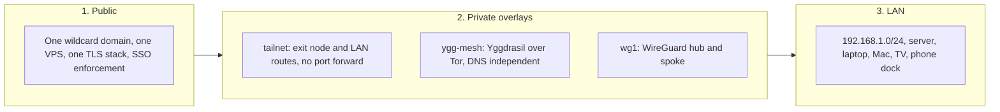
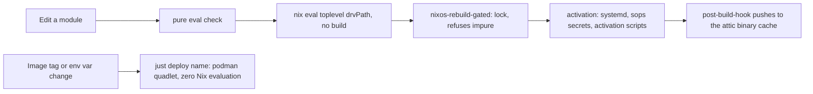
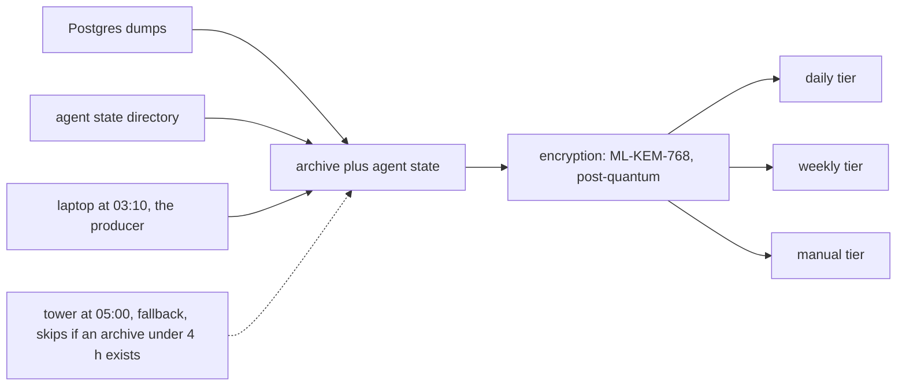
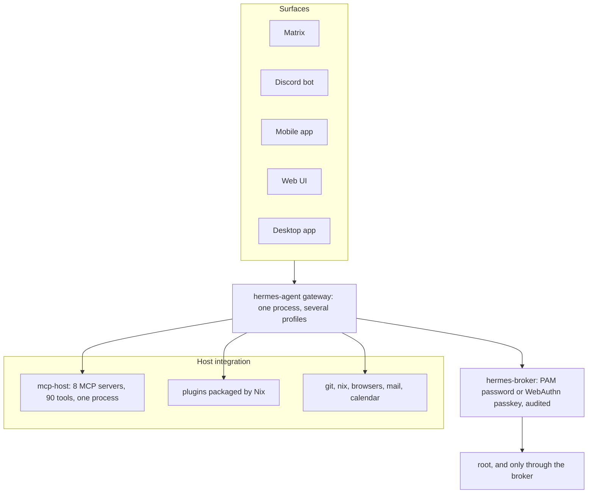

# nixos

**A private cloud that one person runs.** Six machines, one flake, one public entry point, a few dozen self-hosted services, encrypted secrets in the repo, and an AI agent that operates the whole thing under audit. Rebuilding any machine from bare metal is a single command.

This repo is the source of truth: configuration, services, secrets, network routes, backups, and the agent that drives them. Nothing is installed by hand, and nothing is clicked in a web UI that could have been declared.

## The 30 second version

| | |
|---|---|
| What it is | A reproducible, single-operator infrastructure: 6 machines, 133 service modules, ~52 000 lines of Nix, 42 encrypted secret files |
| What runs | Media, photos, files, code hosting, mail, Matrix, DNS, password vault, remote desktops, a Kubernetes console, a job queue, an observability stack, an LLM gateway |
| How it is exposed | One wildcard domain, one VPS, one TLS termination, SSO in front of everything that does not authenticate itself |
| How it is protected | Zero plaintext secret in git, post-quantum encrypted backups, one audited path to root, no manual deployment step |
| Why it exists | Because owning production systems is the fastest way to learn them, and because renting all of this would be neither cheaper nor more reliable |

## What this proves, if you are evaluating it

- **Systems design under real constraints.** A CPU only server, 62 GB of RAM, one 1.4 TB pool at 75 % full, and a dozen always-on services competing with builds. The interesting engineering is at the resource ceiling: cache capped, compressed swap promoted, evaluation time treated as a first class metric.
- **Security by construction, not by policy.** No secret is ever in plaintext: 194 encrypted fields across 42 sops files. The agent has no ambient root: one broker, two possible proofs, everything logged.
- **Automation economics.** Configuration has a cost and I measure it. One stale `builtins.getFlake` made every evaluation of the server take 863 s instead of 139 s. A per session MCP process model reached 133 processes and 1.7 GB where one shared process holds the same 8 servers in 85 MB. Those numbers drove the architecture, not taste.
- **Operational honesty.** The limits section below lists what is a single point of failure, what is lightly used, and what is disabled. A repo that only advertises its strengths is a marketing page.

## How to read this repo in ten minutes

| File | What it shows |
|---|---|
| `flake.nix` | One entry point, every machine, every input pinned |
| `profiles/tower/configuration.nix` | The real composition, with the reasoning kept in comments: memory tuning, tunnels, ACLs, scheduling |
| `services/newt/default.nix` | Routing declared in Nix, including the SSO switch per domain |
| `services/hermes-broker/` | The only path to root, with its own README |
| `deploy/containers.nix` | Why containers escaped the host config, and how |
| `scripts/pure-check.sh` | A linter that forbids the impure shortcuts that break evaluation |
| `services/backup-pqbox/` | Post-quantum encrypted backups and their documentation |

## Public links

Everything answers under one wildcard domain. Most surfaces return an SSO wall to an anonymous visitor, which is the point: identity is checked before the app sees the request.

| Surface | URL | Access |
|---|---|---|
| 3D map of the whole stack | <https://atlas.marcpartensky.com> | SSO (Zitadel via Pangolin) |
| Agent console | <https://dash.marcpartensky.com> | SSO |
| Web terminal | <https://terminal.marcpartensky.com> | SSO |
| Remote desktop in the browser | <https://kasm.marcpartensky.com> | SSO |
| Tailnet view | <https://mesh.marcpartensky.com> | SSO |
| LLM spend per model and per key | <https://usage.marcpartensky.com> | SSO |
| Kubernetes console | <https://rancher.marcpartensky.com> | SSO |
| Job queue | <https://windmill.marcpartensky.com> | SSO |
| Process monitor | <https://proc.marcpartensky.com> | SSO |
| Photos | <https://immich.marcpartensky.com> | SSO |
| Notebook and research | <https://notebook.marcpartensky.com> | SSO |
| Files and calendar | <https://cloud.marcpartensky.com> | app login |
| Code hosting, this repo is mirrored there | <https://git.marcpartensky.com/mazex/nixos> | app login, public repos readable |
| Documentation wiki | <https://wiki.marcpartensky.com> | app login |
| Flashcard sync | <https://anki.marcpartensky.com> | app login |
| Mail | <https://mail.marcpartensky.com> | app login |
| Media server | <https://jellyfin.marcpartensky.com> | app login |
| Agent web UI | <https://hermes.marcpartensky.com> | app login |
| File drops and share pages | <https://drop.marcpartensky.com> | public |

## Architecture

### The map



### One request, end to end



Two consequences: tower never holds a TLS certificate and never accepts an inbound connection from the internet, and adding a domain is a rebuild rather than a click in someone else's dashboard.

### Three network layers



The overlays are not redundant toys. The tailnet is how the phone reaches the LAN from anywhere. ygg-mesh keeps a path alive when DNS or the control plane is unhappy. WireGuard `wg1` is the older path that a few services still use to reach the LAN through the VPS.

### Change flow, and why evaluation cost matters



`--impure` is refused for both the user and the agent, because an impure evaluation hides what a machine actually depends on. Rebuilds are serialized by a lock: two parallel activations have corrupted `/etc/passwd` permissions in the past. Containers that only carry an image tag were moved out of the host config entirely, so bumping a version does not cost a 90 s evaluation.

### Data and backups



### The agent layer



The consolidation is deliberate: one MCP process holds 8 servers and 90 tools in 85 MB, where a process per session reached 133 processes and 1.7 GB.

### What runs where

| Domain | Services |
|---|---|
| Edge and networking | `pangolin`, `newt`, `traefik`, `headscale`, `tailscale`, `ygg-mesh`, `wireguard`, `adguard` (DNS, also bound on the tailnet), `tor` |
| Identity and secrets | `zitadel` (OIDC), `vaultwarden` on the VPS, `hermes-broker` |
| Files and sync | `nextcloud` with Postgres, Redis and nginx; `immich` on an external read-only photo library with indexing limited to a nightly window; `gitea`; `syncthing`; a phone photo mirror to S3 |
| Media | `jellyfin`, `navidrome` with `aonsoku` and `octo`, `audiobookshelf`, `radarr`/`sonarr`/`readarr`/`prowlarr`/`flaresolverr`, `qbittorrent`/`rqbit`, `go2rtc` |
| Communication | `matrix-synapse` with `mautrix` bridges for WhatsApp, Signal, Discord, Meta and LinkedIn; `stalwart` mail; `gotify` and its Matrix bridge |
| Knowledge | `anki-sync-server` plus a headless Anki MCP, `open-notebook`, Wiki.js and a static docs comparison, `jupyterhub` |
| Small tools | `shlink` short links with an S3 to link to share page flow, `reactive-resume`, `thclaws`, an F-Droid repo, `windmill` |
| Remote access | `rustguac` (Guacamole compatible), `kasmvnc` (Plasma in the browser plus a visible Chromium with CDP for automation), `novnc`, `rustdesk`, `ttyd` with `zellij`, `eternal-terminal` |
| Cluster | `k3s` single node serving the Rancher console on a fixed ClusterIP, with no port open anywhere |
| Job queue | `windmill`: server and database on tower, workers on the Deck, the VPS and the laptop, over the tailnet |
| Observability | `zabbix` server plus an agent everywhere, `uptime-kuma`, `glances`, `atop` with peak history, a tailnet dashboard, an LLM spend dashboard, a daily finance dashboard, and the 3D stack map |

## Decisions I would defend in an interview

| Decision | Measured effect |
|---|---|
| Cap the ZFS ARC at 16 GB | Uncapped it grew to 61 GB of 62 and pushed builds into swap: evaluation went from 90 s to 236 s. Capped, the machine stays responsive under build load |
| Promote zram above disk swap | Default priorities sent everything to the NVMe: 13.5 GB of 16 GB disk swap used while 120 KB of the 15.6 GB zram was touched. Priority 110 removed multi second freezes |
| Remove one `builtins.getFlake` from the server config | It rehashed a 16 GB working tree at every evaluation: 863 s down to 139 s, and pure evaluation became possible again |
| One shared MCP process instead of one per session | 133 processes and 1.7 GB down to one process and 85 MB for the same 8 servers and 90 tools |
| Move pure containers out of the host config | Bumping an image tag no longer costs a 90 s idle evaluation, several minutes under load |
| Serialize rebuilds behind a lock and refuse `--impure` | Two parallel activations had corrupted system file permissions, and an impure evaluation hides real dependencies |
| Post-quantum encryption for backups | A backup decrypted ten years from now should not depend on a classical key exchange that may be broken by then |
| One audited broker instead of sudo for the agent | Root access becomes a logged event with two authentication options, not an ambient capability |

## Operations

`.env` sets the defaults: `HOST=tower`, `HM=marc`, `RUN=nixos`.

| Command | Effect |
|---|---|
| `just` | `just nixos` (via `RUN`) |
| `just nixos` | `flock` then `sudo nixos-rebuild-gated switch --flake .#$HOST`, never `--impure` |
| `just home` | `home-manager switch --flake .#$HM`, run as the desktop user |
| `just mac`, `just droid` | the Mac and the phone |
| `just deploy <name>` | render a container quadlet and restart it, no NixOS rebuild |
| `just mcp-deploy` | sync the MCP modules and restart mcp-host, no rebuild |
| `just vm`, `just iso`, `just install` | dev microvm, installer image, bare metal install |

Cleanroom rebuild of a machine: boot the ISO, run `just install`, done. No dotfile farm, no post install ritual.

## Observability

A server that cannot be measured cannot be defended, so the stack is instrumented at four levels: host (`atop` per process with peak history, `glances`), service (`zabbix` agents reporting to the VPS, `uptime-kuma`), network (a tailnet dashboard) and money (`usage-dashboard` for LLM spend per model and per key, `finance-dashboard` for daily expenses). The 3D map reads all of it live and is generated from the actual state rather than drawn by hand.

## Repo layout

```
flake.nix              every nixosConfigurations / homeConfigurations / darwinConfigurations
Justfile + .env        common commands
profiles/<host>/       per machine composition: imports, firewall, hostname, sops file
  common/              base shared by tower and laptop
hosts/<name>/          disko and hardware configuration per machine
modules/nixos/<name>/  unit system modules, enabled by being imported
modules/home/<name>/   Home Manager modules
users/                 desktop profile standalone, root inside NixOS, Mac and Deck profiles
services/<name>/       one folder per service, registry in services/default.nix
  hermes/plugins/      Nix managed plugins for the agent
mcp/                   mcp-host: one process serving the hand written MCP servers
deploy/                containers moved out of the host config
secrets/*.yml          sops age ciphertext
scripts/, vms/         helpers and microvm definitions
```

`services/` is imported by tower and laptop only. The Deck and the VPS pick modules one at a time, because a module without an `enable` option would activate on every host.

## Machines

| Flake output | Machine | Role |
|---|---|---|
| `nixosConfigurations.tower` | Ryzen 7 4800H mini-PC, 62 GB RAM, 1.4 TB ZFS on root via disko | The server, CPU only |
| `nixosConfigurations.laptop` | 3060 mobile, the only CUDA machine | Local LLM endpoints and TTS, backup producer |
| `nixosConfigurations.deck` | Steam Deck, Jovian-NixOS | Console, plus a queue worker and scheduled jobs |
| `nixosConfigurations.anywhere` | RackNerd VPS | Public entry, identity, mail, observability |
| `nixosConfigurations.laptop-iso` / `deck-iso` | | Installer images |
| `nixosConfigurations.dev` | microvm.nix | Disposable dev VM |
| `homeConfigurations.marc` | Home Manager standalone | Desktop profile, deliberately not wired into any host |
| `homeConfigurations."marc@macos"` / `"marc@deck"` | Home Manager | Mac and Deck profiles |
| `darwinConfigurations.macos` | nix-darwin | The Mac |
| `nixOnDroidConfigurations.default` | nix-on-droid | The phone, including its tunnel back to the LAN |

`nixpkgs` is pinned to `nixos-26.05`, with `unstable` for packages missing from it, and the Darwin channel for the Mac.

## Secrets (sops-nix)

- 42 files under `secrets/`, one per domain, encrypted with sops and age, 194 encrypted fields in total.
- One age key per machine in `.sops.yaml`. `common.yml` is readable by every machine; each profile points `sops.defaultSopsFile` at its own file.
- A new secret file needs only the public keys already in `.sops.yaml`:

```
nix run nixpkgs#sops -- -e --filename-override secrets/<name>.yml --output secrets/<name>.yml <plaintext>
```

Editing an existing file in place requires the private key, and therefore runs as root on that machine.

## Conventions

- Comments and commit messages are in French, conventional commits, grouped by logical theme rather than one commit per file.
- A module is enabled by being added to an import list; commented out means disabled but kept as reference.
- The desktop Home Manager profile never appears inside a `nixosConfigurations`: only `root` goes through the system.
- The repo is edited concurrently by several sessions and agents, so rebuilds are serialized and a commit always carries an explicit path list.

## Known limits

- tower is CPU only, no CUDA and no ROCm, and runs a single 1.4 TB pool at roughly 75 % full. Memory is the real ceiling: 62 GB, a 16 GB ARC cap, and a disk swap that used to thrash. GPU work is delegated to the laptop.
- The VPS is a single point of failure: DNS, TLS, tunnels, identity and mail all live there. Losing it takes every domain down even though the server at home keeps running.
- There is no CI and no automated deployment. Validation is `nix eval`, a dry build, then a switch, one machine at a time.
- Rancher, rustguac and the Kasm desktop are useful but lightly exercised. Several modules (`kanidm`, `syncserver`, `minio`, `dnscrypt`, `matrix-telegram`, `waydroid`) exist and are disabled, kept as reference rather than as working features.
- The Deck and the Mac are rebuilt rarely, so their configurations can lag behind the shared modules.

## What a public repo exposes

Everything under `secrets/` is sops ciphertext, and no private key, token or password was ever committed, checked across the entire history. Cloning this repo grants no access to anything.

What it does disclose is the shape of the infrastructure: service inventory and versions, hostnames, internal addresses for the LAN, the tailnet and WireGuard, local ports, the reverse proxy layout, the SSH public keys of the machines, and my email addresses. That is the usual trade off for a public infrastructure repo: useful to read, mildly useful for reconnaissance, and largely discoverable anyway for anything that answers on a public domain, since certificate transparency logs already list every subdomain.

## License

No license file yet. Published as a reference: read it, learn from it, and expect paths, users and domains to be specific to this setup.
