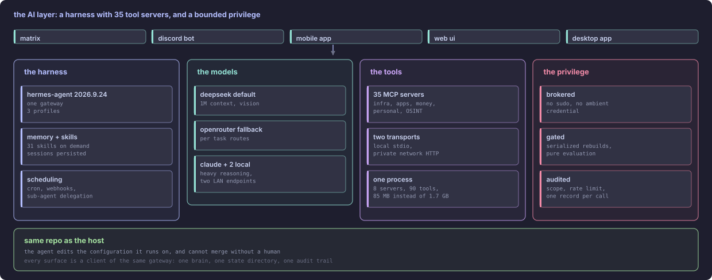
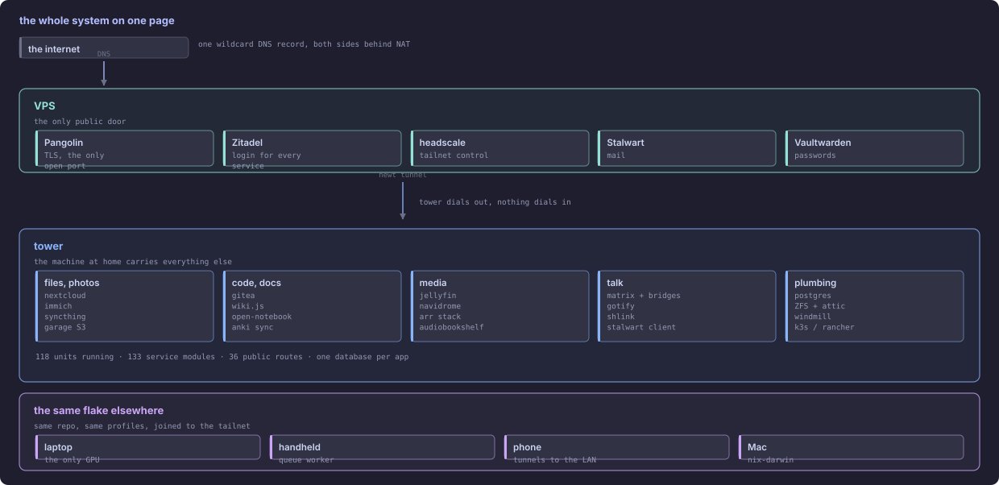
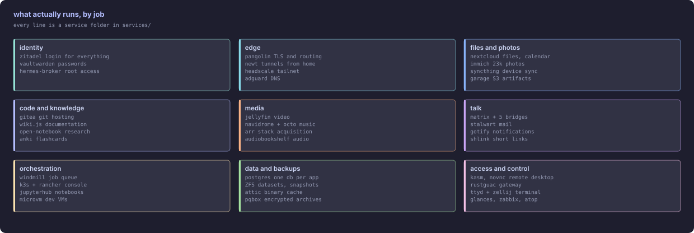

# nixos

**The infrastructure behind an AI agent that operates real systems.** One flake describes six machines and 118 services; on top of them runs a harness with 35 tool servers, several model providers, and an agent that can act on the machines instead of only talking about them.

## The AI layer



Four things make it usable, in this order:

- **A harness, not a wrapper.** One gateway process holds three profiles, 31 skills loaded on demand, persistent memory, cron, webhooks and sub-agent delegation, and serves five surfaces: Matrix, Discord, mobile, web and desktop. Every surface is a client of the same brain, not a separate deployment.
- **Models routed per task.** A cheap model with a large context by default, a fallback provider, an auxiliary vision model, a heavy model only where it pays, and two local endpoints on the GPU machine. Spend is tracked per model and per key, because that is what decides whether an agent runs all day or only in a demo.
- **The tool plane is the real work.** 35 MCP servers reach infrastructure, self-hosted apps, accounts, media and public datasets over two transports: local stdio and HTTP on the private network. A process per session had grown to 133 processes and 1.7 GB; one shared process now holds 8 servers and 90 tools in 85 MB.
- **Acting is bounded.** The agent has no sudo and no ambient credential. Root goes through a broker that takes a password or a passkey, scopes the request, rate limits it and writes a record. Rebuilds are serialized and refuse impure evaluation, so a bad change is a rollback, and the agent edits the same repository it runs on without being able to merge alone.

Written up for a general audience, with no internal address: **[AI infrastructure: the harness, the models, the tools, the privilege](https://drop.marcpartensky.com/73a63cf5)**. French version: [Infra IA](https://drop.marcpartensky.com/82ef90ae).

## The platform underneath



Six machines, one public door, one outbound tunnel. The VPS terminates TLS and enforces identity; the machine at home holds no certificate and accepts no inbound connection. Adding a domain is a rebuild, not a click in a dashboard.

- **One login.** Zitadel for the apps that speak OIDC. For those that cannot, the proxy checks the session before forwarding, so an app with no auth of its own never sees an anonymous request. One attribute per route decides which model applies.
- **Data.** One database and role per app, declared in the flake. ZFS datasets for the rest, and an object store for build artifacts and the phone photo tree.
- **Backups.** A second machine pulls dumps and agent state on its own schedule and encrypts them before they leave, so the server cannot delete its own history.
- **Rebuild.** Boot the installer, run `just install`, done. No dotfile farm, no post-install ritual.

## What runs



## Public links

Most surfaces answer with an SSO wall to an anonymous visitor, which is the point: identity is checked before the app sees the request. The two write-ups are the exception, they are meant to be read.

| | |
|---|---|
| AI infrastructure write-up | <https://drop.marcpartensky.com/73a63cf5> · [FR](https://drop.marcpartensky.com/82ef90ae) |
| 3D map of the whole stack | <https://atlas.marcpartensky.com> (SSO) |
| Agent console | <https://dash.marcpartensky.com> (SSO) |
| Files and calendar | <https://cloud.marcpartensky.com> (app login) |
| Photos | <https://immich.marcpartensky.com> (SSO) |
| Code hosting, this repo is mirrored there | <https://git.marcpartensky.com/mazex/nixos> (app login, public repos readable) |
| Documentation wiki | <https://wiki.marcpartensky.com> (app login) |
| Media server | <https://jellyfin.marcpartensky.com> (app login) |
| File drops and share pages | <https://drop.marcpartensky.com> (public) |

## Files worth opening

| File | What it shows |
|---|---|
| `flake.nix` | One entry point, every machine, every input pinned |
| `services/hermes-broker/` | The only path to root for the agent, with its own README |
| `mcp/` + `modules/nixos/mcp-host/` | The tool plane: one process, many servers, hot reload without a rebuild |
| `services/newt/default.nix` | Exposure and auth policy declared in Nix, per route |
| `services/backup-pqbox/` | Backup tiers, post-quantum encryption, restore notes |
| `docs/diagrams/build.py` | The figures in this README are generated from this script, not drawn by hand |

## What this is not

- **Not a product.** No users, no revenue, no market. It is a working system and a set of decisions.
- **Not a scale story.** One node with a few workers. The interesting properties are tooling, identity and bounded privilege, not throughput.
- **Not audited.** No external review, no pen test, no SOC 2. The claim is narrower: no plaintext secret in git, a restore path that exists, and an auditable privilege boundary.
- **Not operated by a team.** The concurrency problems here are the ones an agent creates, not the ones a team creates.

## Known limits

- The single VPS at the edge is a single point of failure: DNS, TLS, tunnels, identity and mail all live there.
- There is no CI and no automated deployment. Validation is a pure evaluation, a dry build, then an activation, one machine at a time.
- Some modules exist as reference rather than as working features (`kanidm`, `syncserver`, `minio`, `dnscrypt`, `matrix-telegram`, `waydroid`).
- Configuration and commit messages are in French, which is a real barrier for an English speaking reviewer.

## Security

Every secret is sops ciphertext and no private key, token or password was ever committed, checked across the whole history. Cloning this repo grants no access to anything. What it does disclose is the shape of the system: service names and versions, hostnames, internal addressing, local ports, SSH public keys, and the reverse proxy layout. That is largely discoverable anyway for anything answering on a public domain, since certificate transparency logs already list every subdomain.

## Operations

`.env` sets the defaults: `HOST`, `HM`, `RUN`.

| Command | Effect |
|---|---|
| `just nixos` | lock, then the gated switch for `$HOST`, never `--impure` |
| `just home` | the desktop Home Manager profile, as the desktop user |
| `just deploy <name>` | render a container quadlet and restart it, no NixOS rebuild |
| `just mcp-deploy` | sync the MCP modules and restart mcp-host, no rebuild |
| `just vm`, `just iso`, `just install` | dev microvm, installer image, bare metal install |

## Repo layout

```
flake.nix              every nixosConfigurations / homeConfigurations / darwinConfigurations
profiles/<host>/       per machine composition: imports, firewall, hostname, sops file
hosts/<name>/          disko and hardware configuration per machine
modules/nixos/<name>/  unit system modules, enabled by being imported
modules/home/<name>/   Home Manager modules
users/                 desktop profile standalone, root inside NixOS, Mac and handheld profiles
services/<name>/       one folder per service, registry in services/default.nix
  hermes/plugins/      Nix managed plugins for the agent
mcp/                   mcp-host: one process serving the hand written MCP servers
deploy/                containers moved out of the host config
docs/diagrams/         generated SVG figures, next to the script that builds them
secrets/*.yml          sops age ciphertext
scripts/, vms/         helpers and microvm definitions
```

## License

No license file yet. Published as a reference: read it, learn from it, and expect paths, users and domains to be specific to this setup.
