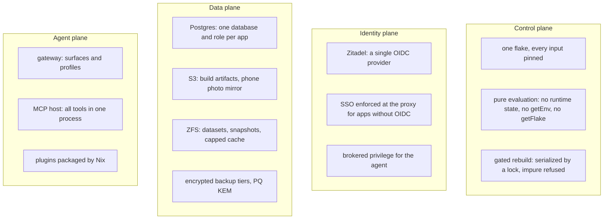
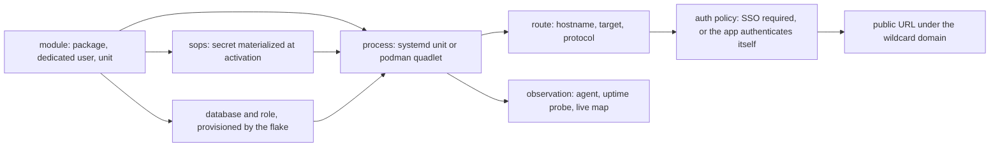
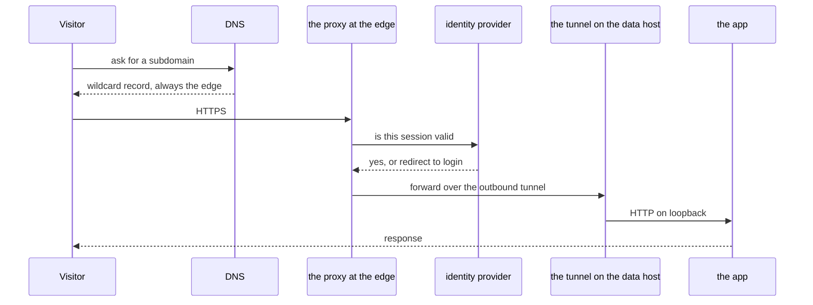
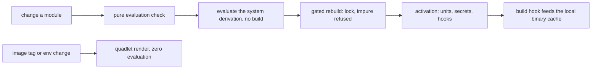
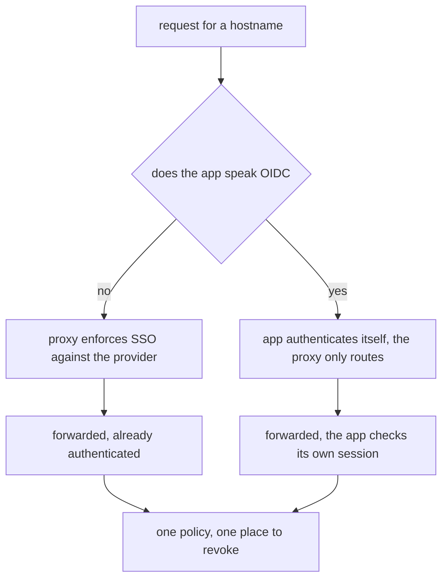
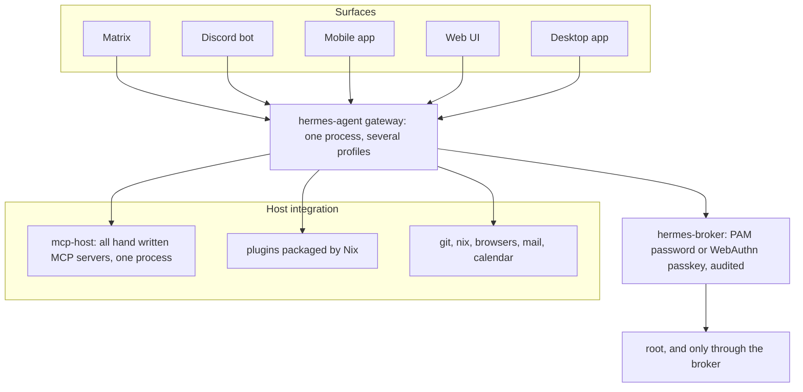
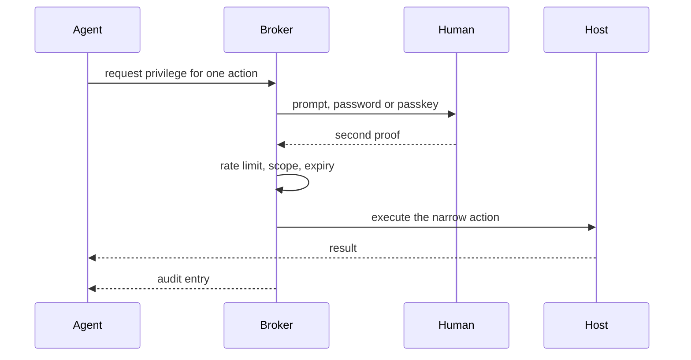

# nixos

**An internal platform for one person, built as if it had to serve a hundred.** One flake describes every machine, every service, every secret, every public route and the AI agent that operates the whole thing under audit. Nothing is configured by hand at runtime, and nothing is clicked in a web UI that could have been declared.

This repo is the source of truth. The interesting part is not the desktop: it is the software layer of the cloud. A control plane that refuses drift, an identity plane that covers services which have no authentication of their own, a data plane with a tested restore path, and an agent plane where an autonomous process holds tools instead of credentials.

## The 30 second version

| Plane | What it is made of |
|---|---|
| Control plane | One flake, pinned inputs, pure evaluation, rebuilds behind a lock, no runtime configuration drift |
| Identity plane | One OIDC provider for the services that speak OIDC, SSO at the reverse proxy for those that do not, brokered and audited privilege for the agent |
| Data plane | One database and role per app, an S3 object store for artifacts and phone photos, ZFS datasets and snapshots, three encrypted backup tiers |
| Agent plane | A gateway multiplexing several surfaces and profiles, a single MCP host holding all tools, plugins packaged by Nix, one audited path to root |
| Exposure plane | One wildcard domain, 36 routes declared in Nix, TLS and identity decided at the edge, no inbound connection to the server at home |
| Shape of the codebase | 133 service modules, about 52 000 lines of Nix, 42 encrypted secret files, 118 services running on the main host |

## What this proves, if you are evaluating it

- **Platform engineering, not system administration.** Every capability a service needs has a declared contract: package, unit, secret, route, auth policy, observation. A service that forgets one of them fails at evaluation, not in production at 3 a.m.
- **Identity as a platform feature.** Most self-hosted apps either cannot do OIDC or do it badly. Instead of accepting a second login per app, the proxy enforces identity upstream, and the app sees an already authenticated request. One attribute per route decides it.
- **Data lifecycle with a restore path.** The producer of the backups is not the machine that holds the data, so compromising the server does not destroy its history. Archives are encrypted with a post-quantum KEM, tiered daily, weekly and manual, and the restore procedure is documented rather than remembered.
- **Agent operations, which is where this gets unusual.** An autonomous agent works on the same repo that defines the host it runs on. That is only safe because privilege is brokered, rebuilds are gated and serialized, and the agent cannot merge its own changes without a human decision.
- **Cost engineering.** Configuration has a price and I measure it: 863 s of evaluation became 139 s, one MCP process replaced 133, and containers escaped the host config so an image bump costs seconds instead of minutes. Efficiency here is a design constraint, not an optimisation pass.

## How to read this repo in ten minutes

| File | What it shows |
|---|---|
| `flake.nix` | One entry point, every machine, every input pinned |
| `services/default.nix` | The service registry and why some modules stay out of it |
| `services/newt/default.nix` | Exposure declared in Nix, including the auth policy per route |
| `services/hermes-broker/` | The only path to root for the agent, with its own README |
| `deploy/containers.nix` | Why containers escaped the host config, and how |
| `scripts/pure-check.sh` | A linter that forbids the impure shortcuts that break evaluation |
| `services/backup-pqbox/` | Backup tiers, post-quantum encryption, restore notes |

## Public links

Everything answers under one wildcard domain. Most surfaces return an SSO wall to an anonymous visitor, which is the point: identity is checked before the app sees the request.

| Surface | URL | Access |
|---|---|---|
| 3D map of the whole stack | <https://atlas.marcpartensky.com> | SSO (Zitadel via Pangolin) |
| Agent console | <https://dash.marcpartensky.com> | SSO |
| Web terminal | <https://terminal.marcpartensky.com> | SSO |
| Remote desktop in the browser | <https://kasm.marcpartensky.com> | SSO |
| Tailnet view | <https://mesh.marcpartensky.com> | SSO |
| LLM spend per model and key | <https://usage.marcpartensky.com> | SSO |
| Kubernetes console | <https://rancher.marcpartensky.com> | SSO |
| Job queue | <https://windmill.marcpartensky.com> | SSO |
| Process monitor | <https://proc.marcpartensky.com> | SSO |
| Photos | <https://immich.marcpartensky.com> | SSO |
| Notebook and research | <https://notebook.marcpartensky.com> | SSO |
| Files and calendar | <https://cloud.marcpartensky.com> | app login |
| Code hosting, this repo is mirrored there | <https://git.marcpartensky.com/mazex/nixos> | app login, public repos readable |
| Documentation wiki | <https://wiki.marcpartensky.com> | app login |
| Flashcard sync | <https://anki.marcpartensky.com> | app login |
| Mail | <https://mail.marcpartensky.com> | app login |
| Media server | <https://jellyfin.marcpartensky.com> | app login |
| Agent web UI | <https://hermes.marcpartensky.com> | app login |
| File drops and share pages | <https://drop.marcpartensky.com> | public |

## The software layer

### Four planes, one source of truth

### The contract of a service

Adding a service is not copying a unit file. It is declaring six things, and forgetting one is a failure at evaluation time.

Consequences worth stating: there is no port published to the internet anywhere in this repo, no service holds a TLS certificate except the one at the edge, and a new domain is a rebuild rather than a dashboard click in someone else's product.

### One request, end to end

The data host holds no certificate and accepts no inbound connection. Identity is decided before the app is reached, and the app keeps its own session only if it knows how.

### Control plane: no runtime configuration

- **One flake, pinned.** `nixpkgs` is pinned by channel, upstream projects by revision, and packages that are not in nixpkgs are packaged here with real hashes. If it is not in the flake, it does not exist on the machine.
- **Pure evaluation as a rule.** No `builtins.getFlake`, no `getEnv`, no `pathExists` outside the store in any evaluated module. Anything that reads external state becomes an input. `scripts/pure-check.sh` fails the build if a shortcut sneaks back in.
- **Rebuilds are gated.** A wrapper sits in front of `nixos-rebuild` for both the human and the agent: it refuses `--impure` and serializes activations with a lock, because two parallel activations had already corrupted system file permissions.
- **Two speeds.** Container-only changes go through `just deploy`, which renders a podman quadlet and restarts it with zero Nix evaluation. Everything structural goes through the flake. Choosing per service which speed it deserves is the point.
- **Reversibility.** Every generation is a store path, so a bad change is a rollback, not an archaeology project. A machine can be rebuilt from bare metal with one command.

Two speeds on purpose: structural changes go through the flake and pay the evaluation, containers do not. Deciding per service which speed it deserves is the difference between a platform and a ritual.

### Identity plane: one provider, two enforcement points

- **Apps that speak OIDC** authenticate themselves against Zitadel: code hosting, notification, photos, wiki, monitoring, the agent console.
- **Apps that cannot** inherit identity from the proxy. Pangolin checks the session before forwarding, so an application with no auth of its own never receives an anonymous request. That single capability is what makes exposing small tools safe here.
- **One attribute per route** decides which model applies, which is why the exposure table above can be honest about which surfaces use SSO and which use their own login.
- **Secrets follow the same logic.** 42 sops files, one age key per machine, 72 declared secret references, 194 encrypted fields. A stolen machine decrypts its own file and the shared one, nothing else. No secret has ever been in plaintext in this repo, across the whole history.
- **Privilege is a service, not a capability.** The agent has no sudo. It asks a broker, which accepts a PAM password or a WebAuthn passkey, records the request, rate limits it, and grants the one thing asked for.

### Data plane: lifecycle over storage

- **A database per app**, declared in the flake with its role, provisioned at activation. No shared schema between services, so a restore of one app never depends on another.
- **An object store** for what is not relational: build artifacts, and a mirror of the phone photo tree with one bucket per source.
- **ZFS with a capped cache and compressed swap.** The cache was allowed to grow until services swapped: capping it took evaluation from 236 s under pressure back to 90 s, and giving compressed swap a higher priority than the disk stopped the multi second stalls.
- **Backups where the producer is not the server.** A second machine pulls dumps and agent state over SSH, on its own schedule, and the server only runs a fallback that skips if a fresh archive exists. Archives are encrypted before they leave, with a post-quantum KEM, in three tiers. The reasoning is simple: a backup that the compromised machine can delete is not a backup.

- **A local binary cache** fed by the build hook, so a garbage collection or a flake update does not recompile what was already built here.

### Agent plane: tools instead of credentials

The design choices that matter: **one gateway process** multiplexes surfaces and profiles, so a Discord bot is a client of the same brain rather than a second deployment. **One MCP host** holds every tool in a single process, because a process per session reached 133 processes and 1.7 GB where one holds the same tools in 85 MB. **Tools are code, not prompts**: each MCP server is a small program in this repo, packaged and restarted by the flake or hot-reloaded without one. And the agent works on the same repository that defines the host, which is why the control plane is so strict about purity and locking.

### Supply chain and packaging

The unglamorous half of the work. Upstream projects get packaged here when nixpkgs does not have them, which means dealing with real hash mismatches, Go version constraints, npm dependency sets, and vendored Chart versions. Container images that are just an image tag were moved out of the host configuration entirely, and the ones that remain are pinned. The binary cache is local, the secrets are per machine, and nothing in the deployment path is downloaded at activation time except the declared inputs.

### Observability as a feedback loop

Four levels, each answering a different question: host (`atop` per process with peak history, `glances`), service (`zabbix` agents reporting to the VPS, `uptime-kuma` probes), network (a tailnet dashboard), and money (LLM spend per model and per key, daily expenses). The 3D map of the stack is generated from live state rather than drawn by hand, so it cannot drift from reality.

### Fleet, by role

The platform does not care which box does what. One machine carries the services. One workstation has the GPU and is used only for local model inference and speech. One handheld is a queue worker and runs scheduled jobs. One small VPS holds the public edge, identity and mail. A laptop on macOS and a phone are managed by the same repository as everything else, which is the real test of a platform: the model does not change when the hardware does.

### What runs

| Domain | Services |
|---|---|
| Edge and networking | `pangolin`, `newt`, `traefik`, `headscale`, `tailscale`, `ygg-mesh`, `wireguard`, `adguard` (DNS), `tor` |
| Identity and secrets | `zitadel` (OIDC), `vaultwarden`, `hermes-broker` |
| Files and sync | `nextcloud` with Postgres, Redis and nginx; `immich` on an external read-only photo library with indexing limited to a nightly window; `gitea`; `syncthing` |
| Media | `jellyfin`, `navidrome` with `aonsoku` and `octo`, `audiobookshelf`, `radarr`/`sonarr`/`readarr`/`prowlarr`/`flaresolverr`, `qbittorrent`/`rqbit`, `go2rtc` |
| Communication | `matrix-synapse` with `mautrix` bridges for WhatsApp, Signal, Discord, Meta and LinkedIn; `stalwart` mail; `gotify` and its Matrix bridge |
| Knowledge | `anki-sync-server` plus a headless Anki MCP, `open-notebook`, Wiki.js and a static docs comparison, `jupyterhub` |
| Small tools | `shlink` short links with an S3 to link to share page flow, `reactive-resume`, `thclaws`, an F-Droid repo, `windmill` |
| Remote access | `rustguac` (Guacamole compatible), `kasmvnc` (a full desktop in the browser plus a visible Chromium with CDP for automation), `novnc`, `rustdesk`, `ttyd` with `zellij`, `eternal-terminal` |
| Cluster | `k3s` single node serving the Rancher console on a fixed ClusterIP, with no port open anywhere |
| Job queue | `windmill`: server and database on the main host, workers on the other machines, over the tailnet |
| Observability | `zabbix` server plus an agent everywhere, `uptime-kuma`, `glances`, `atop`, a tailnet dashboard, an LLM spend dashboard, a daily finance dashboard, the 3D stack map |

## Decisions I would defend in an interview

| Decision | Measured effect |
|---|---|
| Cap the filesystem cache instead of letting it grow | Uncapped, the cache consumed the machine until services swapped: evaluation took 236 s under pressure against 90 s at rest. Capped, the host stays responsive while builds run |
| Give compressed swap a higher priority than disk swap | With default priorities the disk swap filled while the compressed one sat idle, and the desktop froze for tens of seconds. Inverting the priority removed the stalls |
| Remove one `builtins.getFlake` from the host config | It rehashed a large working tree at every evaluation: 863 s down to 139 s, and pure evaluation became possible again |
| One shared MCP process instead of one per session | 133 processes and 1.7 GB down to one process and 85 MB for the same tools |
| Move pure containers out of the host config | Bumping an image tag no longer costs a full evaluation, several minutes under load |
| Serialize rebuilds behind a lock and refuse `--impure` | Two parallel activations had corrupted system file permissions, and an impure evaluation hides real dependencies |
| Enforce identity at the proxy for apps that have none | One provider, no per app password sprawl, and small tools can be exposed without writing auth |
| Post-quantum encryption for archives | A backup decrypted years from now should not depend on a classical key exchange that may not survive |
| One audited broker instead of sudo for the agent | Root becomes a logged, rate limited event with two possible proofs, not an ambient capability |

## Operations

`.env` sets the defaults: `HOST`, `HM`, `RUN`.

| Command | Effect |
|---|---|
| `just` | `just nixos` (via `RUN`) |
| `just nixos` | lock, then the gated switch for `$HOST`, never `--impure` |
| `just home` | the desktop Home Manager profile, as the desktop user |
| `just mac`, `just droid` | the Mac and the phone |
| `just deploy <name>` | render a container quadlet and restart it, no NixOS rebuild |
| `just mcp-deploy` | sync the MCP modules and restart mcp-host, no rebuild |
| `just vm`, `just iso`, `just install` | dev microvm, installer image, bare metal install |

Cleanroom rebuild of a machine: boot the ISO, run `just install`. No dotfile farm, no post install ritual, no memory of what was done last time.

## What this is not

- **Not a product.** No users, no revenue, no market. It is a working system and a portfolio of decisions.
- **Not a scale story.** It is a single node with a handful of workers. The interesting properties are reproducibility, identity and privilege, not throughput.
- **Not audited.** There is no external security review, no pen test, no SOC 2. The claim is narrower: no plaintext secret in git, a tested restore path, and an auditable privilege boundary.
- **Not operated by a team.** Concurrency problems here are ones an agent creates, not ones a team creates. That is a different failure mode than on-call in a company.

## Known limits

- The single VPS at the edge is a single point of failure: DNS, TLS, tunnels, identity and mail all live there. Losing it takes every domain down, even though the services at home keep running.
- There is no CI and no automated deployment. Validation is a pure evaluation, a dry build, then an activation, one machine at a time. A real fleet would want checks in a pipeline and a canary stage.
- Some modules exist as reference rather than as working features (`kanidm`, `syncserver`, `minio`, `dnscrypt`, `matrix-telegram`, `waydroid`), and a few surfaces are lightly exercised: the cluster console, the remote desktop gateway, the Kasm session.
- Machine resource tuning is empirical, driven by measurements, and the numbers are specific to this hardware. The method transfers, the values do not.
- Configuration and commit messages are in French, which is a real barrier for an English speaking reviewer.

## What a public repo exposes

Everything under `secrets/` is sops ciphertext, and no private key, token or password was ever committed, checked across the entire history. Cloning this repo grants no access to anything.

What it does disclose is the shape of the system: service inventory and versions, hostnames, internal addressing, local ports, the reverse proxy layout, the SSH public keys of the machines, and my email addresses. That is the usual trade off for a public infrastructure repo: useful to read, mildly useful for reconnaissance, and largely discoverable anyway for anything that answers on a public domain, since certificate transparency logs already list every subdomain.

## License

No license file yet. Published as a reference: read it, learn from it, and expect paths, users and domains to be specific to this setup.
